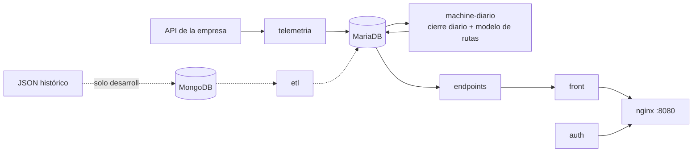

# Artisa Transportes

Monitoreo de la flota con la telemetría GPS real de la empresa: dónde está cada camión, qué hizo
cada día, qué rutas usa la flota (aprendidas por machine learning) y alertas cuando un camión
sale de ellas.

- **Instalar en un equipo nuevo (un solo comando):** `bash instalar.sh` desde `Capstone Artisa` · detalle y operación: [docs/INSTALACION.md](docs/INSTALACION.md)
- **Web:** http://localhost:8080 (o `http://IP-DEL-SERVIDOR:8080` desde la red), usuario `admin`
- **Comandos:** `python3 scripts/artisa.py --help`



## Servicios (Docker Compose)

| Servicio | Qué hace |
|---|---|
| `telemetria` | Trae los reportes de la API de la empresa cada 30 s. Si se corta la red, recupera lo pendiente sin duplicar. |
| `machine-diario` | Cada día a las 00:30 cierra el día anterior y reentrena el modelo de rutas; cada minuto revisa y guarda las alertas. |
| `mariadb` | Base de datos (volumen persistente). |
| `endpoints` | API de solo lectura para la web (`/api/*`) y el asistente (`/api/chat`). |
| `front` + `nginx` | La web; nginx es la única entrada (puerto 8080). |
| `auth` | Inicio de sesión (contraseña con hash, sesión de 12 h). |
| `respaldo` | Respaldo diario de la base en `respaldos/` (03:00). |
| `mongodb` + `etl` | Solo en desarrollo, para cargar el JSON histórico. |

## Reglas clave

- **Día:** de 00:00 a 00:00 hora de Chile. Ningún reporte queda fuera ni se cuenta dos veces.
- **Recorrido:** solo se unen reportes seguidos (5 min o menos y bajo 150 km/h). Los saltos de GPS no se dibujan.
- **Parada:** 10 min dentro de 200 m. Una espera larga (por ejemplo, cargando) es una parada.
- **Viaje:** recorrido entre dos paradas. Los viajes partidos por la medianoche se empalman.
- **Camiones:** solo los del catálogo `DB/vehiculos_data.sql`. No se guarda el RUT del conductor.

### Machine learning: el modelo que aprende las rutas

Todo está en un archivo, `machine_learning/modelo_rutas.py`, dividido en partes. Es
aprendizaje no supervisado: nadie le dice cuáles son las rutas, las descubre en los viajes reales.

| Parte | Qué hace | Algoritmo |
|---|---|---|
| 1. Viajes | Detecta paradas y viajes de cada camión | Reglas de parada y recorrido |
| 2. Datos | Toma los viajes de los últimos 90 días con origen y destino | — |
| 3. Lugares | Agrupa las paradas cercanas (500 m) en lugares; dentro de una faena, el lugar es la faena | **DBSCAN** |
| 4. Rutas | Junta los viajes que siguen el mismo camino entre dos lugares (750 m) y dibuja cada ruta con un viaje real | **Clustering jerárquico** + **medoide** |
| 5. Niveles | Clasifica cada ruta según cuántos camiones distintos la usan | **Cortes naturales de Jenks** |
| 6. Entrenamiento | Se reentrena cada día y prevé las rutas de los próximos 7 días | — |
| 7. Validación | `python3 scripts/artisa.py rutas` reentrena y muestra la tabla de niveles | — |

**Niveles:** N1 troncal, N2 muy usada, N3 uso medio y N4 poco usada (los rangos los aprende el
modelo) · **N5 mínima** = 1 o 2 camiones · **N6 fuera de ruta** = un camión donde no hay ninguna
ruta aprendida.

**Alerta:** un camión en movimiento, fuera de las faenas, en N5 o N6 por 10 min o más y a 2 km o
más de una ruta habitual (N1–N4). Es algo para revisar, no una falta comprobada.
`machine-diario` las revisa cada minuto (Parte 8 del modelo) y las guarda en la tabla
`alertas_ruta`: cuándo empezó y terminó cada una, cuánto duró, nivel, km recorridos y camino
seguido. Así quedan como registro aunque el camión vuelva a su ruta.

**Cortes de señal (Parte 9):** si un camión en movimiento fuera de las rutas habituales pasa más
de 5 min sin posición nueva, se guarda en `cortes_senal`: último reporte antes (hora, lugar,
velocidad, motor), primero después y la distancia en línea recta entre ambos. "GPS sin posición
nueva" = siguieron llegando copias del mismo reporte (el equipo transmitía, pero sin GPS);
"Sin datos" = no llegó nada. Es un indicio para revisar, no una prueba.

## Web

| Sección | Para qué sirve |
|---|---|
| Camiones en vivo | Dónde está cada camión y qué hizo cada día: recorrido, viajes, paradas, reportes y últimos 30 días. |
| Rutas y alertas | Rutas previstas para los próximos 7 días con su nivel (N1–N5), camiones en vivo encima, alertas y tabla de niveles. "Historial" muestra las alertas ya terminadas por día, 7 días o mes y las descarga en CSV (Excel); las abiertas están en "Activas" y "Sin señal". Al final, plegado, "¿Cómo funciona el modelo?". |
| Datos históricos | Mapas de días pasados (hasta 14 días): calor, rutas por camión, uso de rutas y puntos. |
| Dashboard | Datos por camión en el mes elegido o en todo el historial. Arriba, la tabla de todos los camiones con sus filtros; abajo, las anomalías del período en toda la flota (sin esos filtros): lo que más se sale de lo normal (más paradas, más tiempo detenido, más km, más detención por distancia, más días sin reportes) y dos comparaciones (más paradas, tiempo detenido o km; y los que menos reportaron frente a la mediana de la flota); la tabla trae reportes, km, días con datos, paradas, tiempo detenido, nivel de reporte A–D y último día con datos. La tabla también se ve "Mes a mes" (reportes o km de cada camión por mes). Cada camión se abre día por día. Descarga en CSV: la tabla por camión o el detalle día por día, con los filtros activos. |
| Asistente | Chat abajo a la derecha que responde sobre la flota, las rutas y las alertas. |
| Arquitectura | Estado de cada servicio. |

## Asistente (IA)

- Usa Gemini (gratis desde Google AI Studio). La clave va **solo** en `.env` (`GEMINI_API_KEY`);
  sin clave, el chat avisa que no está configurado y el resto funciona igual.
- Responde con estas reglas y con los mismos resultados que muestra la web. Solo lectura: nunca
  recibe conductores, RUT ni coordenadas.
- Límites: 500 caracteres por pregunta, 6 por minuto y 200 por día.

## Estructura

```
DB/                 esquema y catálogos (vehículos, faenas)
telemetria_api/     conector de la API de la empresa
machine_learning/   cierre diario y modelo de rutas (modelo_rutas.py)
endpoints/          API de la web y asistente
front/  auth/  nginx/
scripts/            artisa.py (comandos), arranque, respaldo y comprobaciones
ETLs/               carga del JSON histórico (solo desarrollo)
tests/              pruebas: python3 -m unittest discover -s tests
```

## Seguridad

- Las claves viven solo en `.env` (se crea solo y no se sube a Git).
- La conexión a la API de la empresa es de solo lectura (`SELECT`) y no modifica su base.
- **Nunca** usar `docker compose down -v`: borra la base de datos.
